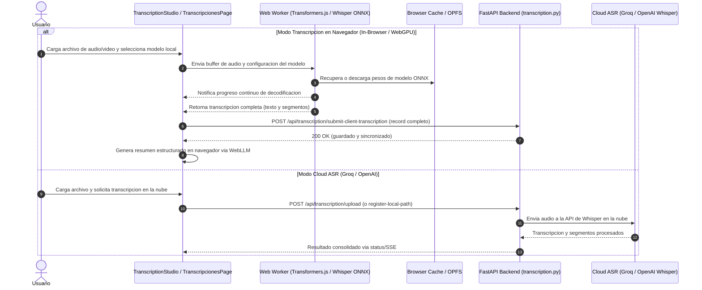

# Arquitectura y Flujo del Proceso de Transcripcion

Este documento describe la arquitectura integral y el ciclo de vida del procesamiento de transcripciones de audio y video en la plataforma FuncAssist. El sistema esta disenado bajo un modelo **Client-First**: la inferencia local de voz se ejecuta íntegramente en el navegador del usuario via WebGPU/WASM, eliminando pesos de modelos y ejecucion de inferencia local en el backend.

---

## 1. Diagrama de Flujo y Secuencia Client-First

---

## 2. Componentes Principales y Responsabilidades

### 2.1. Frontend (Ejecucion de Inferencia)

* **`BrowserAsrProvider.ts` / Web Worker:**
  * Responsable de la carga y ejecucion de modelos Whisper en ONNX (`@huggingface/transformers`).
  * Utiliza WebGPU si la tarjeta grafica y el navegador lo soportan; conmuta a WASM multihilo como respaldo.
  * Almacena en cache local del navegador los modelos (`onnx-community/whisper-tiny`, `onnx-community/whisper-base`, `onnx-community/whisper-small`).
  * Emite eventos granulares de progreso y genera segmentos con marcas de tiempo precisas.

* **`clientTranscription.ts`:**
  * Orquesta la decodificacion en el cliente.
  * Tras completar la transcripcion acustica, envia el resultado final al backend mediante `POST /api/transcription/submit-client-transcription`.
  * Solicita la generacion de resumen en cliente usando WebLLM si el modo de redaccion esta configurado en navegador, evitando depender de un modelo LLM local en el servidor.

* **`TranscriptionStudio.tsx` & `TranscripcionesPage.tsx`:**
  * Visualizacion y edicion de segmentos en tiempo real.
  * Mapeo y renombrado de interlocutores.
  * Exportacion de documentos funcionales (Inventario de Requerimientos en XLSX, Levantamiento Detallado en DOCX).

---

### 2.2. Backend (Orquestacion, Almacenamiento y Cloud Proxy)

* **Politica de Cero Inferencia Local:**
  * El backend no incluye dependencias pesadas de inferencia local (`openai-whisper`, `faster-whisper`, `onnxruntime`, `ctranslate2`, `llama-cpp-python`).
  * No descarga ni aloja archivos `.pt`, `.bin` o `.gguf`.
  * Todo intento de invocar inferencia local en el backend es rechazado con error de validacion.

* **Endpoints de Transcripcion:**
  * `POST /api/transcription/submit-client-transcription`: Recibe la transcripcion ya decodificada por el navegador, asigna identificadores y guarda el registro con metadatos.
  * `POST /api/transcription/register-local-path`: Vinculacion de archivos locales sin copia redundante en entornos de escritorio.
  * `POST /api/transcription/transcribe/{id}`: Reservado exclusivamente para derivacion a APIs cloud (Groq Cloud Whisper o OpenAI Whisper) cuando el usuario tiene configurada su respectiva API key.
  * Los endpoints legados como `/api/transcription/retranscribe/{id}` han sido removidos.

* **Almacenamiento y Estructura GUID:**
  * Cada transcripcion genera una carpeta identificada por GUID dentro de `USER_DATA_DIR/transcriptions/<id>/` que contiene el medio original y los metadatos correspondientes.

---

## 3. Limpieza de Directorios Legados en Disco

Con la transicion a inferencia en navegador y proveedores cloud externos, los directorios locales previamente utilizados para almacenar pesos de modelos pueden eliminarse de forma manual con seguridad para recuperar espacio en disco:

* `data/models/whisper/` (modelos `.pt` de OpenAI Whisper)
* `data/models/builtin/` (modelos `.gguf` descargados por el backend)
* `~/.cache/whisper/` (cache global de la libreria Whisper en el perfil de usuario)

El sistema ya no consulta ni crea estas rutas en tiempo de ejecucion.
